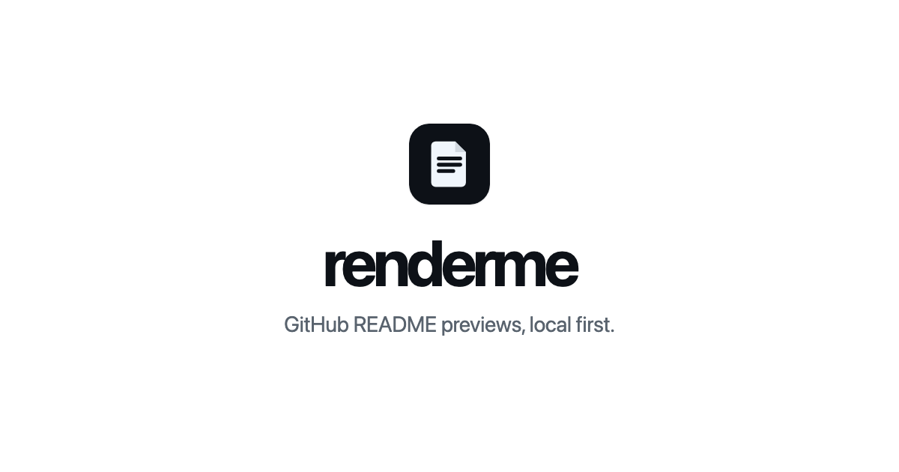

# renderme

A local-first README studio that recreates the GitHub repository preview before you push.

## Features

- GitHub-like repository chrome and markdown rendering
- File explorer with folders, uploads, rename and delete
- Relative image resolution for assets such as `.github/assets/preview.svg`
- LICENSE, CONTRIBUTING, CODE_OF_CONDUCT and `.github` templates
- ZIP import/export
- Browser-local persistence with IndexedDB
- Static Cloudflare Workers deployment

## Branding

The project mark is intentionally close to GitHub's visual language: one monochrome rounded square, one document glyph and no decorative gradients.

| Asset | Use |
| --- | --- |
|  `public/logo.svg` | Light backgrounds |
|  `public/logo-dark.svg` | Dark backgrounds |
|  `public/og-card.png` | Open Graph/Twitter/Discord previews |

Keep the mark monochrome, lowercase the `renderme` wordmark and give the logo at least half its width as clear space.

## Develop

```sh
npm install
npm run dev
```

## Build

```sh
npm run build
npm run lint
```

## Deploy to Cloudflare Workers

```sh
npm run build
npx wrangler deploy
```

For CI, set `CLOUDFLARE_API_TOKEN` and `CLOUDFLARE_ACCOUNT_ID` in the repository secrets.

## License

Apache-2.0. See [LICENSE](LICENSE).
